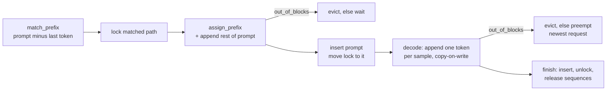
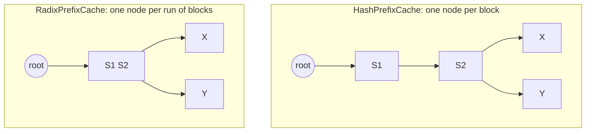

# radix-kv

The memory-management core of an LLM inference server's KV cache in C++20, with Python bindings:
a PagedAttention-style block allocator with copy-on-write, and two prefix caches (vLLM-style
chained block hashes and an SGLang-style radix tree) that you can compare in a trace-driven
scheduler simulation.

[](https://github.com/aozmekik/radix-kv/actions/workflows/ci.yml)
[](LICENSE)

> **Status:** early, v0.1.0. The API may change. Not yet published to PyPI or any package
> registry. There is no GPU code and there are no tensors: the library manages block ids and
> metadata, the way an engine's scheduler does.

## Why

An LLM server keeps the attention keys and values (the KV cache) of every running request in
accelerator memory. PagedAttention ([Kwon et al., SOSP 2023](#references)) stores that cache in
fixed-size blocks, so memory does not fragment and sequences can share blocks. Prefix caching goes
further and reuses the blocks of a shared prompt prefix (a system prompt, few-shot examples, an
earlier chat turn) across requests. vLLM finds reusable blocks through chained hashes of full
blocks; SGLang ([Zheng et al., NeurIPS 2024](#references)) keeps a radix tree of token sequences.

radix-kv implements both strategies on the same allocator and the same ownership model, with the
invariants spelled out and tested, so the two can be studied and compared without a GPU, and the
pieces can be reused in a scheduler.

## Features

- **`BlockAllocator`**: fixed pool of `N` blocks of `B` tokens, O(1) allocate, retain and release,
  reference counts, an all-or-nothing batch allocate and peak tracking.
- **`Sequence`**: tokens plus block table with RAII release; `fork()` shares every block, and an
  append into a shared, partially filled block copies it first and reports a `CopyOp` (src, dst)
  for the engine (parallel sampling, beam search). `truncate()` and `assign_prefix()` included.
- **`HashPrefixCache`**: chained 64-bit block hashes, a hash-to-block index and LRU eviction of
  unlocked blocks.
- **`RadixPrefixCache`**: radix tree over whole blocks with `match_prefix`, `insert`,
  `lock`/`unlock` for running requests, node splitting and LRU eviction of unlocked leaves.
- **No false hits**: every hash hit is confirmed against the stored token ids.
- **Errors without exceptions** on hot paths: `Result<T>` is `std::expected` in C++23 and a
  compatible fallback in C++20.
- **Simulator**: deterministic synthetic workloads (multi-turn chat, few-shot, RAG, uniform
  random) and a continuous-batching scheduler that reports hit rate, evictions, preemptions, peak
  blocks, copy-on-write copies and cache operations per second for each strategy.
- **Python bindings** (nanobind, scikit-build-core) with type stubs; `simulate()` releases the GIL.
- **Tests**: GoogleTest unit tests, randomized invariant and differential tests with fixed seeds,
  a libFuzzer target, sanitizer presets, Google Benchmark microbenchmarks.

## Install

### Python

Not yet published to PyPI. Install from GitHub (this compiles the C++ extension, so a C++20
compiler is needed; pip fetches CMake and Ninja if they are missing):

```sh
pip install "git+https://github.com/aozmekik/radix-kv"
```

The CI workflow is configured to build and test the package on Python 3.11 to 3.14, on Linux and
macOS.

### C++ with CMake

```cmake
include(FetchContent)
FetchContent_Declare(
  radix_kv
  GIT_REPOSITORY https://github.com/aozmekik/radix-kv
  GIT_TAG v0.1.0)  # or a commit SHA
FetchContent_MakeAvailable(radix_kv)

target_link_libraries(your_target PRIVATE radix_kv::radix_kv)
```

As a subproject it builds only the library: no tests, tools or `-Werror`. To install it instead
(the library, headers, CMake package, the `radix-kv-sim` tool and the license):

```sh
cmake -S . -B build/install -DCMAKE_BUILD_TYPE=Release -DRADIX_KV_BUILD_TESTS=OFF \
  -DRADIX_KV_BUILD_EXAMPLES=OFF
cmake --build build/install
cmake --install build/install --prefix /your/prefix   # then find_package(radix_kv CONFIG REQUIRED)
```

Compile your code in the same C++ mode as the library: `Result` is `std::expected` in C++23 and a
fallback class in C++20, and a mix of the two fails to link
([ADR 0003](docs/adr/0003-result-type-with-std-expected-fallback.md)).

## Quick start

C++ ([full example](examples/cpp/quickstart.cpp)):

```cpp
#include <span>

#include "radix_kv/radix_kv.hpp"

namespace rk = radix_kv;

// Prefills one request, reusing the cached prefix of its prompt, and decodes a token on a fork.
rk::Result<void> run_request(rk::BlockAllocator& pool, rk::RadixPrefixCache& cache,
                             std::span<const rk::TokenId> prompt, rk::TokenId next_token) {
  // The last prompt token is always recomputed: the engine needs its logits.
  const rk::PrefixMatch hit = cache.match_prefix(prompt.first(prompt.size() - 1));
  if (auto locked = cache.lock(hit.node); !locked) {  // pin the shared blocks while in use
    return locked;
  }
  rk::Sequence seq(pool);
  auto ready = seq.assign_prefix(prompt.first(hit.num_tokens), hit.blocks);
  auto appended = seq.append(prompt.subspan(hit.num_tokens));
  if (!appended && appended.error() == rk::Errc::out_of_blocks) {
    cache.evict(pool.blocks_for(prompt.size()));  // drop unlocked cached blocks, then retry
    appended = seq.append(prompt.subspan(hit.num_tokens));
  }
  if (!ready || !appended) {
    static_cast<void>(cache.unlock(hit.node));
    return rk::fail(!ready ? ready.error() : appended.error());  // e.g. queue the request
  }

  // Parallel sampling: a fork shares every block until one of them writes.
  if (auto sample = seq.fork()) {
    if (auto step = sample->append(next_token); step && step->copy) {
      // The engine copies the KV data of block step->copy->src into step->copy->dst.
    }
  }

  // Done: cache the full blocks and drop the lock; `seq` releases its references.
  static_cast<void>(cache.insert(seq.tokens(), seq.block_table()));
  return cache.unlock(hit.node);
}
```

Python ([full example](examples/python/quickstart.py)):

```python
import radix_kv as rk

pool = rk.BlockAllocator(num_blocks=1024, block_size=16)
cache = rk.RadixPrefixCache(pool)
prompt = list(range(100))  # token ids from your tokenizer

hit = cache.match_prefix(prompt[:-1])  # the last prompt token is always recomputed
cache.lock(hit.node)
seq = rk.Sequence(pool)
seq.assign_prefix(prompt[: hit.num_tokens], hit.blocks)
seq.extend(prompt[hit.num_tokens :])  # raises rk.OutOfBlocksError when full
seq.append(7)  # one decode step
cache.insert(seq)  # cache the full blocks, then release the lock
cache.unlock(hit.node)

trace = rk.generate_trace(rk.ChatWorkload(sessions=100), seed=1)
for strategy in (rk.Strategy.none, rk.Strategy.hash, rk.Strategy.radix):
    report = rk.simulate(trace, strategy, rk.SimulatorConfig(num_blocks=4096))
    print(strategy.name, f"{report.hit_rate:.1%}", report.evicted_blocks)
```

Command line:

```sh
radix-kv-sim --workload chat --blocks 1024,4096 --strategy all      # markdown table
radix-kv-sim --workload rag --samples 4 --format csv                 # parallel sampling, CSV
```

## API overview

| Type or function | Role |
|---|---|
| `BlockAllocator` | Pool of reference-counted blocks: `allocate`, `retain`, `release`, `ref_count`, `num_free` |
| `Sequence` | Tokens and block table: `append`, `fork`, `truncate`, `release`, `assign_prefix` |
| `HashPrefixCache`, `RadixPrefixCache` | `match_prefix`, `insert`, `lock`, `unlock`, `evict`, `stats`, `allocator`, `check_invariants` |
| `NullPrefixCache` | Caches nothing; the no-caching baseline |
| `PrefixCache` (concept) | The interface shared by the three caches |
| `Result<T>`, `Errc` | Value-or-error results; `to_string(Errc)` and `describe(Errc)` |
| `generate_trace`, `Trace` | Synthetic workloads, or your own token streams |
| `simulate`, `SimulatorConfig`, `SimulationReport` | Scheduler simulation over a trace |

Every public item has a doc comment in [include/radix_kv](include/radix_kv). The Python API covers
the allocator, sequences, both caches, the workloads and the simulator, with errors raised as
exceptions (see the shipped `_core.pyi` stubs); `NullPrefixCache`, the batch `allocate` and `Errc`
are C++ only.

## How it works

### Ownership: reference counts plus path locks

Every holder of a block, a sequence or a cache, owns exactly one allocator reference, so a block is
free exactly when nobody holds it. Caches additionally count locks per path: running requests lock
the cached prefix they use, and eviction only takes unlocked entries. A forgotten lock can make an
eviction release nothing, but it can never free a block that is in use
([ADR 0001](docs/adr/0001-reference-counts-own-blocks-locks-pin-paths.md)).

This is the request lifecycle the simulator drives (and a scheduler would):



### Two strategies, one trie

Chained hashes make each cached block a node whose parent is the previous block: the hash cache is
an uncompressed trie with one node per block and a hash index over it. The radix tree is the same
trie with chains of single children compressed into one edge. For two cached prompts sharing two
system-prompt blocks:



Both cache exactly the same block-aligned prefixes, so without eviction they return identical hits;
the property tests check this against a naive reference model after every operation. They differ in
cost (the hash cache hashes every block of a query; the tree compares tokens along a few edges) and
in eviction granularity (one block versus a whole leaf).

### Design notes and trade-offs

- **Hits are verified.** Each cache stores the tokens of its blocks and compares them before
  accepting a hash hit, so a collision costs a miss, never wrong KV data
  ([ADR 0002](docs/adr/0002-confirm-every-hash-hit.md)).
- **`std::expected` with a C++20 fallback**; no exceptions on hot paths
  ([ADR 0003](docs/adr/0003-result-type-with-std-expected-fallback.md)).
- **One LRU order for both caches.** Paths are marked used deepest node first, so children always
  precede parents and the eviction victim is always a leaf; the radix tree evicts whole leaves as
  SGLang does ([ADR 0004](docs/adr/0004-shared-lru-order-and-whole-leaf-eviction.md)).
- **Strong guarantee.** A mutation that returns an error or throws `std::bad_alloc` changes
  nothing: `insert` validates every block before touching the cache and rolls back when an
  allocation fails. A fault-injection test fails each allocation of `insert`, `match_prefix`,
  `fork`, `assign_prefix` and `append` in turn and checks that nothing changed. A radix-tree
  `match_prefix` may split a node, which changes the tree's shape but not what is cached.
- **Generation-checked handles.** A stale handle is rejected instead of aliasing a newer node.
  Handles do not record which cache issued them, so use each with its own cache.
- **One C++ mode per program.** `Result` differs between C++20 and C++23, so `result.hpp` makes a
  mix of the two a link error instead of a silent ODR violation
  ([ADR 0003](docs/adr/0003-result-type-with-std-expected-fallback.md)).
- **Scheduler policy (simulator).** First-come first-served admission, one decode token per running
  sample per step, prompt cached right after prefill so later requests can share it, and the last
  prompt token always recomputed because the engine needs its logits. Preemption restarts the most
  recently admitted request: its decode blocks are released without being cached and it decodes
  its output again from the first token. vLLM's recompute preemption keeps the generated tokens and
  re-prefills prompt and output in one pass, so this costs slightly more decode work.
- **Deterministic traces.** The generator uses its own xoshiro256** PRNG and integer sampling, not
  the implementation-defined `<random>` distributions; a golden-fingerprint test pins the output of
  an integer-only trace on every platform.

## Simulation results (synthetic traces)

These are results of the simulator on **synthetic traces** with uniformly random token ids and
illustrative length distributions, not measurements of a real model or real traffic.

```sh
cmake --workflow --preset release
./build/release/tools/radix-kv-sim --blocks 1024,4096,16384
```

Workload defaults as in [workload.hpp](include/radix_kv/workload.hpp) (200 chat sessions with a
shared 1024-token system prompt; 1000 few-shot, RAG and random requests), seed 1, 16-token blocks,
at most 32 running requests. The hit rate counts first admissions only; recomputation after
preemption is reported separately. Hit rates, evictions and preemptions do not depend on timing
and repeat exactly on the same platform; the default workloads draw log-normal lengths and Zipf
popularity through `<cmath>`, so another C library may produce slightly different traces. Run on
an Apple M1 Pro (8 cores), 16 GB, macOS 26, Apple Clang 21.0.0, Release build. No request was
rejected at these pool sizes (the tool's `rejected` column).

| Workload | Pool (blocks) | Hit rate hash | Hit rate radix | Evicted blocks hash | Evicted blocks radix | Preemptions |
|---|--:|--:|--:|--:|--:|--:|
| chat | 1024 | 65.6% | 65.6% | 33,281 | 35,960 | 162 |
| chat | 4096 | 68.0% | 68.0% | 27,485 | 27,567 | 0 |
| chat | 16384 | 93.5% | 93.5% | 0 | 0 | 0 |
| few-shot | 1024 | 89.0% | 86.2% | 14,534 | 18,985 | 207 |
| few-shot | 4096 | 94.5% | 94.5% | 4,847 | 4,849 | 0 |
| few-shot | 16384 | 94.5% | 94.5% | 0 | 0 | 0 |
| rag | 1024 | 22.1% | 21.8% | 110,202 | 116,395 | 118 |
| rag | 4096 | 30.6% | 30.4% | 95,463 | 95,748 | 0 |
| rag | 16384 | 39.7% | 39.7% | 70,930 | 70,955 | 0 |
| random | 1024 to 16384 | 0.0% | 0.0% | 58,338 to 74,574 | 58,343 to 80,732 | 0 to 186 |

Blocks held by running requests at their peak, at 16384 blocks (`peak active`, identical for both
caching strategies): chat 3,130 versus 5,114 without prefix caching, few-shot 1,198 versus 4,031,
RAG 3,853 versus 4,766, random 3,023 versus 3,023.

What the numbers show:

- With room to spare the two strategies agree exactly, as designed (and as the tests require).
- Under memory pressure the radix tree evicts more blocks and loses a little hit rate, because it
  evicts whole leaves where the hash cache evicts single blocks.
- RAG reuse is bounded by document order: only documents identical from the start of the prompt
  are a shared prefix. Prefix caching cannot reuse a popular document retrieved second.
- Sharing prefix blocks among running requests shrinks their working set by up to 70% here
  (few-shot), on top of the compute saved by the hits.

Cache cost at 4096 blocks: median of five runs of
`./build/release/tools/radix-kv-sim --blocks 4096 --format csv` (columns `cache_ops` and
`cache_ms`) on the same machine. Every call is timed with `steady_clock`, so timer overhead is
included, and these are wall-clock times taken while other jobs were running (1-minute load average
about 11 to 12 on 8 cores), so treat them as rough. The call counts are exact and were the same in
every run.

| Workload | Cache calls hash | Cache calls radix | Time in cache hash | Time in cache radix | Calls/s hash | Calls/s radix |
|---|--:|--:|--:|--:|--:|--:|
| chat (767 requests) | 11,349 | 6,144 | 11.3 ms | 2.4 ms | 1.01M | 2.57M |
| few-shot (1000) | 9,665 | 7,978 | 14.8 ms | 3.1 ms | 0.65M | 2.54M |
| rag (1000) | 14,967 | 7,966 | 21.9 ms | 4.2 ms | 0.68M | 1.90M |
| random (1000) | 16,230 | 7,886 | 12.3 ms | 1.9 ms | 1.32M | 4.09M |

The two strategies do not receive the same calls: the hash cache evicts exactly the number of
blocks asked for, so the scheduler calls `evict()` again for nearly every new block once the pool
is full, while a whole-leaf eviction in the radix tree frees room for many steps. Time in cache is
the fairer comparison. `HashPrefixCache` also recomputes the chained hashes of a prompt on every
call, while an engine such as vLLM computes each request's block hashes once and reuses them, so
this comparison overstates the hash strategy's CPU cost.

## Benchmarks

```sh
cmake --workflow --preset release
./build/release/bench/radix_kv_bench --benchmark_repetitions=5 \
  --benchmark_report_aggregates_only=true --benchmark_min_time=0.2s
```

Apple M1 Pro (8 cores), 16 GB, macOS 26, Apple Clang 21.0.0, Release (`-O3`), Google Benchmark
1.10.0. CPU-time medians of 5 repetitions. Other jobs were running on the machine (1-minute load
average 10.7 before and 11.9 after the run), which shows in wall time: wall-time medians were up to
about twice the CPU times and varied by up to 46% (coefficient of variation), while the CPU-time
coefficient of variation stayed at or below 7.5% for every row. All inputs are synthetic.

| Benchmark | `HashPrefixCache` | `RadixPrefixCache` |
|---|--:|--:|
| Match a cached 256-token prefix (full hit) | 566 ns | 134 ns |
| Match a cached 2,048-token prefix | 4,350 ns | 622 ns |
| Match a cached 16,384-token prefix | 37,559 ns | 5,014 ns |
| Match one of 1,024 prompts sharing a 1,024-token prefix | 2,930 ns | 557 ns |
| Fork a cached 512-token prefix, append 256 tokens, insert, evict them | 2,589 ns | 915 ns |
| The same with 2,048 appended tokens | 13,740 ns | 2,337 ns |
| Simulate 200 synthetic few-shot requests (2,048 blocks) | 8.95 ms | 6.76 ms |

| Benchmark | Median |
|---|--:|
| `BlockAllocator` allocate + release | 4.37 ns |
| `Sequence::append` of one token (decode step) | 10.9 ns |
| `fork()` of a 1,000-token sequence + copy-on-write append | 430 ns |
| Simulate the same 200 requests without prefix caching | 4.69 ms |

The radix tree's lookups are faster because they compare token ids along a few edges, while the
hash cache computes one chained hash and one hash-map lookup per block of the query.

## Testing

- `ctest --preset dev` runs 144 tests: 128 GoogleTest cases of the main suite, 5 fault-injection
  cases, 7 command-line checks, a replay of the fuzz harness, the package consumer and 2 example
  runs (the release preset adds a benchmark smoke run: 145). `pytest` runs 36 Python tests
  (Python 3.14.5, pytest 9.1.1).
- Randomized invariant tests (fixed seeds, 8 configurations including tiny pools and a deliberately
  colliding hasher) check after every operation that reference counts equal the holders, that
  locked nodes are never evicted, that matched blocks hold the queried tokens, that no holder sees a
  block change underneath it, that the tree is structurally valid after every split, insert and
  eviction, and that every block is free once all sequences end. Differential tests check that
  both caches return the same hits as a naive reference model.
- Allocation failures: `radix_kv_fault_tests` replaces the global `operator new`, fails each
  allocation of `insert`, `match_prefix`, `fork`, `assign_prefix` and `append` in turn and checks
  after every `std::bad_alloc` that the cache, the sequence and the pool are unchanged. It is not
  built under sanitizers, whose allocators the replacement would bypass.
- `cmake --workflow --preset asan-ubsan` and `--preset tsan` pass, 139 tests each, and
  `--preset cxx23` (where `Result` is `std::expected`) passes 144 (Apple Clang 21.0.0, macOS 26,
  Apple M1 Pro). The ThreadSanitizer run includes a test that runs independent simulations in
  parallel threads; pytest does the same through the bindings, with the GIL released.
- libFuzzer, same driver: `fuzz_prefix_cache -max_total_time=120 -max_len=4096` ran 318,627 inputs
  in 121 s without a failure (Homebrew clang 23.1.3, AddressSanitizer, UBSan set to abort on the
  first report, library asserts on; Apple M1 Pro, load average 9 to 17).
- `./scripts/coverage.sh`: 93.5% of lines, 91.1% of regions and 84.4% of branches of `src/` and
  `include/` are covered by the C++ test suite (Apple Clang 21.0.0 source-based coverage).
- `./scripts/lint.sh` runs clang-format over every C++ file and clang-tidy (strict configuration,
  warnings as errors) over every translation unit of the build: library, tests (including the fuzz
  harness, through its replay driver, and the package consumer), tools, examples, benchmarks and
  bindings. It is clean with the pinned clang-format 23.1.3 and clang-tidy 22.1.8. ruff and
  `mypy --strict` check the Python code.
- Homebrew GCC 14.2 compiles every translation unit of the library, tests, tools and examples with
  the project's warning set and `-Werror`, as C++20 and as C++23, and both GCC-built simulators
  reproduce the few-shot rows at 1024 blocks exactly. GoogleTest itself does not build with this
  GCC against the macOS 26 SDK, so running the suite under GCC is left to the Linux CI jobs.

## Limitations

- A simulation, not an engine: no kernels and no timing model for prefill or decode; a step is one
  token per running sample. All quoted hit rates come from synthetic traces.
- The data structures are not thread-safe, like a scheduler loop; independent instances can be
  used from different threads.
- The radix tree evicts whole leaves and does not re-merge single-child nodes after eviction.
- Only full blocks are cached, one block per distinct prefix; a duplicate computed by another
  request is not cached.
- Each cache keeps a token store of `num_blocks * block_size * 4` bytes.
- The Python API copies token lists (no zero-copy NumPy input). No prebuilt wheels; Windows is not
  tested.
- Preemption restarts a request instead of modelling vLLM's recompute preemption (see the design
  notes), which slightly overstates decode work under memory pressure.
- Block ids are plain integers: a cache can tell that a `Sequence` comes from another pool (and
  rejects it), but not that a list of block ids does.
- Everything above was verified on macOS only. The Linux jobs of the CI workflow (GCC 14, Clang 18,
  the sanitizers, libFuzzer and the Python matrix on Ubuntu) had not run yet when these results
  were recorded.

## Roadmap

- Accept precomputed per-request block hashes in `HashPrefixCache`, as vLLM does.
- Evict only the tail of a long radix leaf (split, then evict) as an option.
- Simulator: a prefill/decode cost model, vLLM-style recompute preemption (keep the generated
  tokens and cache the victim's full blocks) and swap-based preemption, cache-aware scheduling (for
  example longest prefix first), and a trace file format for replaying real tokenized logs.
- Zero-copy NumPy inputs and published wheels.

## Contributing

See [CONTRIBUTING.md](CONTRIBUTING.md) for the build, test, lint and benchmark commands. Design
decisions are recorded in [docs/adr](docs/adr).

## References

- Woosuk Kwon, Zhuohan Li, Siyuan Zhuang, Ying Sheng, Lianmin Zheng, Cody Hao Yu, Joseph E.
  Gonzalez, Hao Zhang, Ion Stoica. "Efficient Memory Management for Large Language Model Serving
  with PagedAttention." SOSP 2023. [arXiv:2309.06180](https://arxiv.org/abs/2309.06180)
- Lianmin Zheng, Liangsheng Yin, Zhiqiang Xie, Chuyue Sun, Jeff Huang, Cody Hao Yu, Shiyi Cao,
  Christos Kozyrakis, Ion Stoica, Joseph E. Gonzalez, Clark Barrett, Ying Sheng. "SGLang: Efficient
  Execution of Structured Language Model Programs." NeurIPS 2024.
  [arXiv:2312.07104](https://arxiv.org/abs/2312.07104)
- vLLM documentation on automatic prefix caching, and the SGLang radix cache, for the behaviour
  modelled here. This is an independent implementation from the papers and public documentation;
  no code was copied.
- MurmurHash3 by Austin Appleby (public domain) for the structure of the block hash; xoshiro256**
  by David Blackman and Sebastiano Vigna for the trace generator.

## License

[MIT](LICENSE)

Built by [Ahmed Semih Özmekik](https://github.com/aozmekik) at [Fergani](https://fergani.tr).
